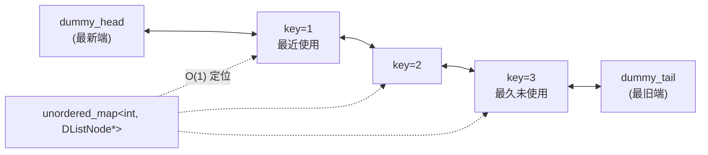

# 链表 (Linked List) — 高频题目框架

> 链表是「指针操作」的试金石。数组题靠下标思考，链表题必须靠**指针的相对运动**思考。
> 本专题覆盖面试出现频率最高的 5 类模式、共 19 道 Easy/Medium 题。

---

## 目录结构

```
src/02-linked-list/
├── README.md                 # 本专题核心笔记
├── CMakeLists.txt            # 构建配置（自动扫描 tests/）
├── list_utils.h              # 公共定义：ListNode / DListNode / 测试工具 / RAII
├── 01_dummy_head.cpp         # 模式一：虚拟头结点（删除类）
├── 02_two_pointers.cpp       # 模式二：快慢指针（找中点 / 判环 / 找位置）
├── 03_reverse.cpp            # 模式三：反转类
├── 04_merge_sort.cpp         # 模式四：合并 / 分组重排 / 排序
├── 05_design.cpp             # 模式五：设计类（LRU / 设计链表 / 大数加法）
└── tests/                    # 单元测试（gtest），命名见 tests/README.md
```

> ⚠️ 当前处于**骨架阶段**：所有函数体为 `// TODO: 实现`，测试目录为空。
>    `cmake --build` 会把骨架整体编译一遍以校验语法，补上测试文件后重新 `cmake ..` 即自动注册。

---

## 链表 vs 数组：思维切换

| 维度 | 数组 | 链表 | 带来的思维转变 |
|:----|:-----|:-----|:--------------|
| 访问 | 随机访问 `a[i]`，O(1) | 只能顺着 `next` 走，O(n) | **位置感消失**，只能靠指针速度差「量」出位置 |
| 定位 | 直接算下标 | 快慢指针 / 定长差值 | 所有「第 k 个」「中点」都要现场推导 |
| 插入删除 | 搬移元素 O(n) | 改指针 O(1) | 但**前提是已经站在前驱结点上** |
| 哨兵 | 无 | 虚拟头结点 dummy | 消除「头结点被删/被换」的分支 |
| 危险点 | 越界 | **断链、成环、丢头、内存泄漏** | 改 `next` 前先存后继 |

---

## 五种模式总览

| 模式 | 移动方式 | 解决的问题 | 典型题 | 复杂度 |
|:----|:--------|:-----------|:-------|:------:|
| **① 虚拟头结点** | 前驱指针 `prev` 从 dummy 出发 | 头结点可能被删除/替换 | LC 203, 83, 82, 19 | O(n) |
| **② 快慢指针** | slow 1 步 / fast 2 步，或定长差值 | 找中点、判环、找交点 | LC 876, 141, 142, 160 | O(n) |
| **③ 反转类** | 三指针 `prev/cur/next` 掉头 | 整条/部分反转及其应用 | LC 206, 92, 24, 234 | O(n) |
| **④ 合并与排序** | dummy + 尾指针 / 双链分流 | 归并、分组、重排 | LC 21, 86, 328, 61, 143, 148, 147 | O(n) / O(n log n) |
| **⑤ 设计类** | 哈希表 + 双向链表 | O(1) 增删查 + 淘汰策略 | LC 707, 146, 2 | 见表格 |

---

## ① 虚拟头结点 (Dummy Head)

### 题目框架

| # | 题目 | 难度 | 核心思想 | 易错点 |
|:-:|:----|:----:|:---------|:-------|
| LC 203 | 移除链表元素 | 🟢 | `prev` 指向待删前驱，命中则 `prev->next = cur->next` | 命中时 `prev` **不**前移 |
| LC 83 | 删除排序链表中的重复元素 | 🟢 | 单指针，`cur->next` 与 `cur` 同值则删 | 删完 `cur` 不前移，才能处理 3 个以上同值 |
| LC 82 | 删除排序链表中的重复元素 II | 🟠 | 探测连续同值区间，整段删除 | 头结点也可能整段被删 → dummy 必需；删除后 `prev` 不动 |
| LC 19 | 删除链表的倒数第 N 个结点 | 🟠 | fast 先走 `n + 1` 步，同步前进后 slow 停在**前驱** | 走 `n + 1` 而非 `n`；`n == 长度` 靠 dummy 统一 |

### 代码模板

```cpp
ListNode dummy(0);            // 栈对象，不要 new
dummy.next = head;
ListNode *prev = &dummy;      // 前驱始终从 dummy 出发

while (cur != nullptr) {
    if (命中删除条件) {
        prev->next = cur->next;   // 摘链
        delete cur;               // 释放（面试可先不写，但要提一句）
        cur = prev->next;
    } else {
        prev = cur;               // 只有不删时才前移
        cur = cur->next;
    }
}
return dummy.next;            // 返回 dummy 的后继，而不是 head
```

---

## ② 快慢指针 (Fast & Slow Pointers)

### 题目框架

| # | 题目 | 难度 | 模式 | 核心思想 | 易错点 |
|:-:|:----|:----:|:----|:---------|:-------|
| LC 876 | 链表的中间结点 | 🟢 | 1:2 速度 | fast 到尾时 slow 即中点 | `while (fast && fast->next)` 才返回**第二个**中点 |
| LC 141 | 环形链表 | 🟢 | Floyd 判圈 | 相遇即有环 | 先判 `fast`、再判 `fast->next`，最后才取 `->next->next` |
| LC 142 | 环形链表 II | 🟠 | Floyd + 数学 | 相遇后 ptr 从头同速走，相遇点即入环点 | 需理解 $a \equiv c \pmod{环长}$ |
| LC 160 | 相交链表 | 🟢 | 定长差值 / 交换赛道 | 长链先走长度差；或 pA 走完 A 走 B | 比较**指针**而非 `val` |

### LC 142 的数学推导

设「头 → 环入口」距离为 $a$，「环入口 → 相遇点」为 $b$，「相遇点 → 环入口」为 $c$，环长 $= b + c$。

- slow 走了 $a + b$
- fast 走了 $a + b + n(b + c)$

由 fast 速度为 slow 的两倍：

$$2(a + b) = a + b + n(b + c) \;\Longrightarrow\; a = (n - 1)(b + c) + c$$

即 $a \equiv c \pmod{b + c}$ —— **从头部走到入口的距离，等于从相遇点绕回入口的距离**。
所以让一个指针从头出发、另一个从相遇点出发同速前进，必在环入口相遇。

### 代码模板

```cpp
// 找中点 / 判环通用骨架
ListNode *slow = head, *fast = head;
while (fast != nullptr && fast->next != nullptr) {   // 顺序不能颠倒
    slow = slow->next;                               // 1 倍速
    fast = fast->next->next;                         // 2 倍速
    if (slow == fast) { /* 有环 */ }
}

// 定长差值（LC 19 / LC 160）
ListNode *fast = head;
for (int i = 0; i < k; ++i) fast = fast->next;       // fast 先走 k 步
ListNode *slow = head;
while (fast != nullptr) { slow = slow->next; fast = fast->next; }
```

---

## ③ 反转类 (Reverse)

### 题目框架

| # | 题目 | 难度 | 核心思想 | 易错点 |
|:-:|:----|:----:|:---------|:-------|
| LC 206 | 反转链表 | 🟢 | 三指针原地掉头（迭代）/ `reverse(head->next)` 后接线（递归） | 改 `cur->next` 前**先存 next**；返回 `prev` 而非 `cur` |
| LC 92 | 反转链表 II | 🟠 | 头插法：把 `cur` 的后继逐个摘到 `prev` 之后 | 定位走 `left - 1` 步；头插过程中 `cur` 自身不动 |
| LC 24 | 两两交换链表中的节点 | 🟠 | dummy + 三指针（`prev/first/second`）逐对交换 | 循环条件两个非空判断缺一不可；`prev` 最终移到 `first` |
| LC 234 | 回文链表 | 🟢 | 找中点 → 反转后半段 → 双端向中间比较 | 奇数长度跳过中间结点；比较完应反转回去保持结构 |

### 代码模板

```cpp
// 迭代反转 —— 必须能默写
ListNode *prev = nullptr, *cur = head;
while (cur != nullptr) {
    ListNode *next = cur->next;    // ① 先存后继
    cur->next = prev;              // ② 掉头
    prev = cur;                    // ③ 前驱后移
    cur  = next;                   // ④ 当前后移
}
return prev;                       // 新头是 prev

// 部分反转（LC 92 头插法）—— 反转 [left, right]
ListNode dummy(0); dummy.next = head;
ListNode *prev = &dummy;
for (int i = 0; i < left - 1; ++i) prev = prev->next;
ListNode *cur = prev->next;
for (int i = 0; i < right - left; ++i) {
    ListNode *moved = cur->next;
    cur->next   = moved->next;
    moved->next = prev->next;
    prev->next  = moved;
}
return dummy.next;
```

---

## ④ 合并与排序 (Merge & Sort)

### 题目框架

| # | 题目 | 难度 | 核心思想 | 易错点 |
|:-:|:----|:----:|:---------|:-------|
| LC 21 | 合并两个有序链表 | 🟢 | dummy + 尾指针逐轮取较小者 | 收尾时剩余子链**整体**挂上，不必逐个搬 |
| LC 86 | 分隔链表 | 🟠 | small / large 两条子链分流后拼接 | `largeTail->next` 必须置 `nullptr`，否则残留后继成环 |
| LC 328 | 奇偶链表 | 🟠 | odd / even 两指针各自成链，交替接线 | 缓存 `evenHead`；循环条件 `while (even && even->next)` |
| LC 61 | 旋转链表 | 🟠 | 求长度并成环 → `k %= n` → 走 `n-k-1` 步断环 | `k` 可达 $2\times10^9$，必须取模；`n == 0` 或整除时直接返回 |
| LC 143 | 重排链表 | 🟠 | 找中点 + 反转后半段 + 交替合并（三步组合拳） | 切分前把前半段尾结点 `next` 置 `nullptr` |
| LC 148 | 排序链表 | 🟠 | 自顶向下归并：找中点 → 断开 → 递归 → `mergeTwoLists` | 递归终止条件含 `head->next == nullptr`；断开前要保存中点 |
| LC 147 | 对链表进行插入排序 | 🟠 | `lastSorted` 维护已排序段，从 dummy 找插入点 | 插入前先 `lastSorted->next = cur->next` 断开 `cur` |

### 代码模板

```cpp
// 合并模板（LC 21 / LC 148 复用）
ListNode dummy(0);
ListNode *tail = &dummy;
while (l1 != nullptr && l2 != nullptr) {
    if (l1->val <= l2->val) { tail->next = l1; l1 = l1->next; }
    else                    { tail->next = l2; l2 = l2->next; }
    tail = tail->next;
}
tail->next = (l1 != nullptr) ? l1 : l2;   // 剩余整体挂上
return dummy.next;
```

```cpp
// 归并排序模板（LC 148）
ListNode *sortList(ListNode *head) {
    if (head == nullptr || head->next == nullptr) return head;
    ListNode *slow = head, *fast = head->next;   // fast 先行一步，使前半段不长于后半段
    while (fast != nullptr && fast->next != nullptr) {
        slow = slow->next;
        fast = fast->next->next;
    }
    ListNode *mid = slow->next;
    slow->next = nullptr;                        // 断开！
    return mergeTwoLists(sortList(head), sortList(mid));
}
```

---

## ⑤ 设计类 (Design)

### 题目框架

| # | 题目 | 难度 | 数据结构组合 | 关键操作 | 复杂度 |
|:-:|:----|:----:|:------------|:---------|:------:|
| LC 707 | 设计链表 | 🟠 | 双向链表 + 虚拟头尾 | 按索引定位时「离哪端近从哪端走」 | 查 $O(\min(k, n-k))$，增删 $O(1)$ |
| LC 146 | LRU 缓存 | 🟠 | 哈希表 + 双向链表 | 命中移到头部；超容量删尾并 `erase` 哈希表 | 平均 $O(1)$ |
| LC 2 | 两数相加 | 🟠 | dummy + 进位变量 | 逐位 `sum = a + b + carry`，新结点存 `sum % 10` | $O(\max(m,n))$ |

### 为什么 LRU 必须是「双向」链表



淘汰最旧结点时需要：

1. 在 $O(1)$ 内拿到它的**前驱**才能改指针 → 单向链表只能从头遍历，必须双向
2. 从 `unordered_map` 中 `erase` 它的 **key** → 结点必须同时存 `key` 和 `val`
3. 虚拟头尾结点 → 省掉「链表为空」「只有一个结点」的特判分支

---

## 易错点清单（面试失分高发区）

| # | 坑 | 后果 | 正确做法 |
|:-:|:---|:-----|:---------|
| 1 | 改 `cur->next` 前没存 `next` | 断链，后续结点全丢 | 循环第一句永远是 `auto next = cur->next;` |
| 2 | 快慢指针循环条件顺序颠倒 | 空指针解引用 crash | 先判 `fast`，再判 `fast->next`，最后才取 `->next->next` |
| 3 | 忘记返回 `dummy.next` | 返回哨兵结点 | 返回值永远从 dummy 取 |
| 4 | `dummy` 用 `new` 分配 | 内存泄漏 / 忘记 `delete` | dummy 用**栈对象**，`ListNode dummy(0);` |
| 5 | 奇偶长度中点定义混淆 | 偶数长度返回错误的中点 | 明确题目要「第一个」还是「第二个」中点 |
| 6 | 拼接两条子链时尾部未置空 | 形成环，遍历死循环 | 拼接前 `tail->next = nullptr;` |
| 7 | 删除结点后没释放内存 | 内存泄漏（面试可提） | `delete` 前先存后继；或直接用 `ListPtr` |
| 8 | LC 61 未对 `k` 取模 | `k` 达 $2\times10^9$，超时 | 先求长度，再 `k %= n` |
| 9 | LC 160 比较 `val` 而非指针 | 值相同但非同一结点时误判 | 用 `pA == pB` 比较指针 |
| 10 | 带环链表直接 `freeList` | 在环中死循环 | 先 `breakCycle()` 再释放 |

---

## 待办区

> 下列题目已确认难度，但本轮骨架**未创建对应实现文件**（见「难度修正说明」）。

### Hard（后续单独攻坚）

| # | 题目 | 难度 | 说明 |
|:-:|:----|:----:|:-----|
| LC 25 | K 个一组翻转链表 | 🔴 | 分组反转 + 组间接线，是 LC 206 + LC 92 的综合升级 |
| LC 23 | 合并 K 个升序链表 | 🔴 | 优先队列（$O(n\log k)$）或分治两两合并 |

### Medium 进阶（暂未建文件）

| # | 题目 | 难度 | 说明 |
|:-:|:----|:----:|:-----|
| LC 138 | 复制带随机指针的链表 | 🟠 | 需扩展 `list_utils.h`，新增含 `random` 指针的 `Node` 结构 |
| LC 725 | 分隔链表 | 🟠 | 按长度均分为 k 段，前 `n % k` 段长 1 |
| LC 430 | 扁平化多级双向链表 | 🟠 | 用栈或递归处理 `child` 指针 |
| LC 1171 | 从链表中删去总和值为零的连续节点 | 🟠 | 前缀和 + 哈希表（与 `01-array-string` 的 LC 560 同源思路） |

**难度修正说明**：原计划曾把 LC 148 / LC 138 / LC 147 归入 Hard 待办，实际三者均为 **Medium**。
其中 LC 148、LC 147 已纳入 `04_merge_sort.cpp`；LC 138 因需要新增结点类型，留待后续处理。

---

## 编译运行

```bash
# 进入本专题目录
cd software-engineer-roadmap/algorithms/src/02-linked-list

# 骨架阶段：仅编译语法校验目标（无需联网拉取 gtest）
mkdir -p build && cd build
cmake .. && cmake --build .

# 补上测试文件后重新 configure，即自动注册并拉取 gtest
cmake .. && cmake --build . && ctest --output-on-failure
```

### 只编译 / 只运行单个测试

```bash
# 只编译某一个测试目标
cmake -DBUILD_TEST_TARGET=reverse_list_test .. && cmake --build .

# 只运行匹配的用例（gtest filter）
cmake -DTEST_FILTER="ReverseListTest.*" .. && cmake --build . && ctest --output-on-failure
```

---

## 参考

- LeetCode 链表标签高频题单
- 《剑指 Offer》第 6、18、22、24、25、35、52 题（与上表题目一一对应）
- 本仓库 `algorithms/src/01-array-string/` —— 数组与字符串专题（前置）
